<p align="center">
  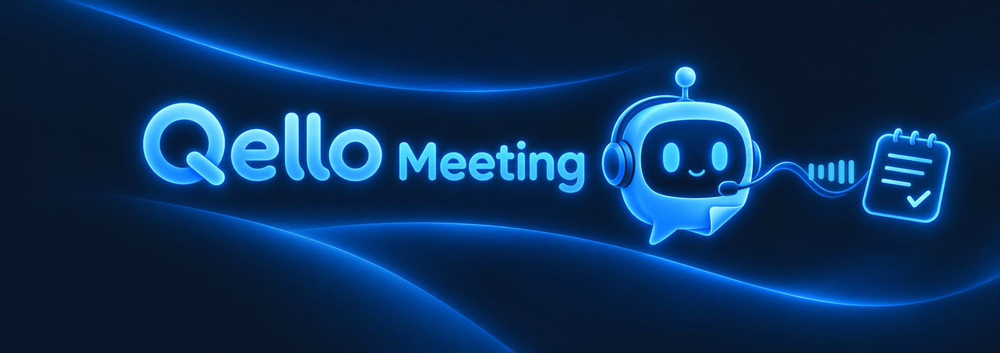
</p>

<p align="center">
  <a href="https://github.com/Qello-Labs/meeting-bot/actions/workflows/harness.yml"></a>
  <a href="https://github.com/Qello-Labs/meeting-bot/actions/workflows/release.yml"></a>
  <a href="https://github.com/Qello-Labs/meeting-bot/releases"></a>
  <a href="https://github.com/Qello-Labs/meeting-bot/deployments/production"></a>
</p>

**Discord 회의**를 말하는 사람별로 녹음하고 **n8n 워크플로**가 **녹취와 회의록 초안**을 만든다.
초안의 결정마다 근거가 실제 입력에 있는지 코드로 확인하고, 팀원이 승인한 회의록만 Confluence `회의록` 페이지 아래에 올린다.

## 목차

1. [개발 배경](#1-개발-배경)
2. [핵심 기능](#2-핵심-기능)
3. [기술 스택](#3-기술-스택)
4. [시스템 구조](#4-시스템-구조)
5. [동작 원리](#5-동작-원리)
6. [데이터 흐름과 인프라](#6-데이터-흐름과-인프라)
7. [기술적 문제와 Trade-off](#7-기술적-문제와-trade-off)
8. [설치와 실행](#8-설치와-실행)
9. [배포와 운영](#9-배포와-운영)
10. [실제 동작 화면](#10-실제-동작-화면)
11. [저장소 구조와 작업 방식](#11-저장소-구조와-작업-방식)

## 1. 개발 배경

Discord에서 주 2회 회의하고 Confluence에 정해진 템플릿으로 회의록을 쓴다(2026-10-17 ClickUp에서 옮김). 일정과 스프린트는 Jira에서 관리한다. 회의 사이의 결정은 Discord 채팅으로 한다.
회의록을 쓰려면 회의 내용을 템플릿에 옮기고 채팅에 흩어진 결정까지 찾아 넣어야 한다.

이 일을 LLM 요약에 맡기면 회의에 없던 결정이 들어갈 수 있다. 그래서 세 가지를 원칙으로 정했다.

- LLM은 템플릿을 채우는 데 사용하고 나머지 처리는 코드가 한다.
- 결정마다 녹취 시각이나 Discord 메시지 링크를 근거로 달고, 근거가 입력에 있는지 코드가 확인한다.
- 사람이 승인한 회의록만 Confluence에 쓴다.

## 2. 핵심 기능

<p align="center">
  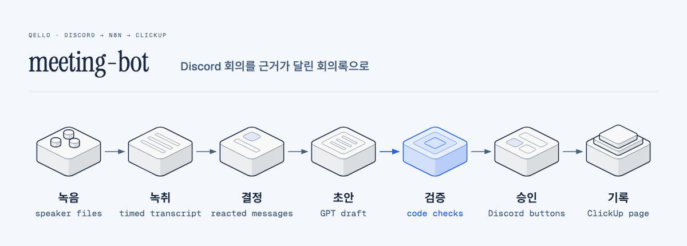
</p>

- **화자별 녹음**: `/회의녹음 시작`부터 `/회의녹음 종료`까지만 녹음한다. Discord가 사용자마다 따로 주는 음성 스트림을 발화 단위 파일로 저장해서 화자 구분 모델이 필요 없다.
- **끊겨도 회의 하나**: 봇 연결이 끊기면 같은 회의로 다시 들어가고, 봇이 재시작돼도 10분 안이면 이어 간다.
- **채팅 결정 수집**: 지난 회의록 이후 ✅ 반응이 달린 메시지를 코드가 고른다.
- **근거 검증**: 결정의 근거가 녹취와 수집한 메시지에 없으면 초안을 승인으로 넘기지 않는다.
- **Discord 버튼 승인**: 팀원 누구나 승인, 수정, 거절할 수 있다. 고친 초안도 같은 규칙으로 다시 검증한다.
- **Confluence 기록**: 승인본을 쓴 뒤 다시 읽어 대조한다.
- **실패 알림**: 어느 단계든 실패하면 회의 채널에 알린다.

## 3. 기술 스택

<p align="center">
  &nbsp;&nbsp;
  &nbsp;&nbsp;
  &nbsp;&nbsp;
  &nbsp;&nbsp;
  &nbsp;&nbsp;
  &nbsp;&nbsp;
  &nbsp;&nbsp;
  
</p>

| 기술                                            | 고른 이유                                                                                                                                                      |
| ----------------------------------------------- | -------------------------------------------------------------------------------------------------------------------------------------------------------------- |
| Node.js 24, discord.js, `@discordjs/voice` 0.19 | 사용자별 음성 스트림을 받는다. 2026년 3월부터 Discord 음성에 필요한 종단 간 암호화(DAVE)를 지원한다                                                            |
| FFmpeg                                          | OpenAI 음성 인식이 ogg를 받지 않아 Opus를 다시 인코딩하지 않고 webm으로 옮긴다                                                                                 |
| n8n 2.42.6                                      | 처음 구상은 스크립트와 GitHub Actions였다. 몇 분 걸리는 음성 인식과 최대 3일의 승인 대기가 들어오면서 Wait, 재시도, 실행 기록이 필요해졌다                     |
| OpenAI `gpt-4o-transcribe`                      | 참석자 이름을 프롬프트로 넘긴다. n8n OpenAI 노드는 `whisper-1` 고정이라 HTTP 노드로 부른다([결정 기록](docs/decisions/2026-10-11-gh13-transcription-nodes.md)) |
| OpenAI `gpt-6-luna`                             | 음성 인식과 제공자를 맞췄다. 형식이 틀린 초안은 검증 코드가 멈추므로 저가형을 골랐다([결정 기록](docs/decisions/2026-10-11-gh17-draft-model.md))               |
| Confluence REST API v2                          | 팀 문서가 있는 곳이다. 템플릿도 실행할 때 읽는다. Markdown API가 없어 저장 형식(XHTML)과 코드로 바꾼다([결정 기록](docs/decisions/2026-10-17-gh31-confluence-minutes.md)) |
| Docker Compose, Oracle A1(arm64)                | 녹음 봇과 n8n이 녹음 볼륨을 공유한다. Always Free 한도 안에서 돈다                                                                                             |
| GitHub Actions, GHCR                            | 승인한 태그만 SSH로 배포하고 기록을 GitHub에 남긴다([결정 기록](docs/decisions/2026-10-13-gh26-ssh-push-deploy.md))                                            |

## 4. 시스템 구조

<p align="center">
  
</p>

서버에는 녹음 봇과 n8n 두 컨테이너가 있고 `recordings` 볼륨을 공유한다. 녹음 봇은 Discord 토큰만 갖고, OpenAI 키와 Atlassian API 토큰은 n8n 자격 증명에만 있다.
서버 인바운드는 SSH뿐이고 n8n은 `127.0.0.1:5678`에만 열린다.

구조를 정한 결정은 다음과 같다. 전체 목록은 [설계 문서 3절](docs/design/meeting-notes.md)에 있다.

- **Webhook은 manifest를 받자마자 응답한다.** 음성 인식이 몇 분 걸려도 녹음 봇 요청이 끊기지 않는다.
- **결정 메시지 조회를 음성 인식보다 먼저 한다.** Discord 조회가 실패하면 유료 음성 인식 전에 멈춘다.
- **승인 버튼이 n8n 실행을 재개한다.** 버튼 ID에 실행 ID, 판 번호, 서명을 넣고 녹음 봇이 Docker 내부의 재개 주소를 부른다. 재개 주소를 밖에 열지 않는다.

### n8n `회의 녹취` 워크플로

<p align="center">
  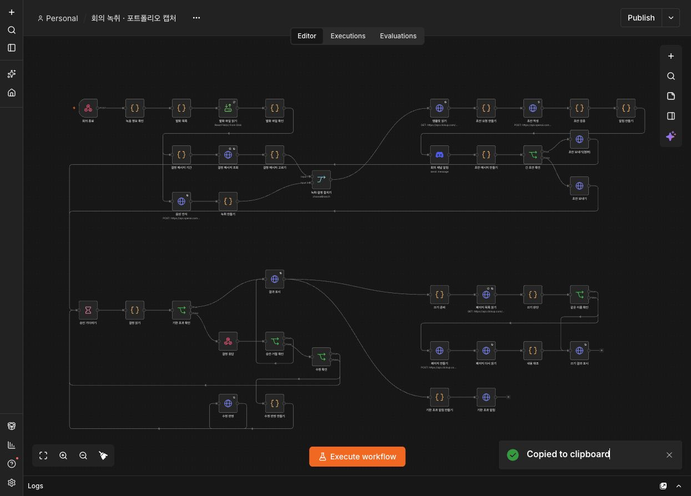
</p>

<p align="center">
  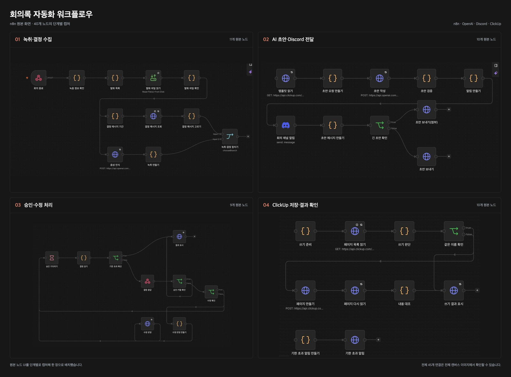
</p>

위는 실제 n8n 화면이고, 아래는 같은 40개 노드를 단계별로 나눠 캡처한 것이다.

- **01 녹취·결정 수집 (11개)**: `회의 종료` Webhook이 manifest를 받자마자 응답하고, `녹음 정보 확인`이 회의 ID와 파일 이름 형식을 검사한다. `발화 파일 확인`은 읽은 파일 수와 순서가 발화 목록과 다르면 멈춘다. 위 갈래(결정 메시지 기간, 조회, 고르기)가 먼저 돌고 아래 갈래(음성 인식, 녹취 만들기)가 뒤에 돌아, Discord 조회가 실패하면 유료 음성 인식 전에 멈춘다. `녹취·결정 합치기`가 두 갈래를 기다린다.
- **02 AI 초안·Discord 전달 (10개)**: Confluence 템플릿을 읽어 Markdown으로 바꾸고 `초안 요청 만들기`가 템플릿, 녹취, 결정 메시지를 태그로 감싸 OpenAI에 보낸다. `초안 검증`이 근거를 확인하고 `회의 채널 알림`이 결과 개수를 알린다. 통과한 초안만 `초안 메시지 만들기`로 가고, `긴 초안 확인`이 4,096자를 넘는 초안은 `.md` 파일을 붙여 보낸다.
- **03 승인·수정 처리 (9개)**: `승인 기다리기`(Wait)가 최대 3일 버튼 클릭을 기다린다. `결정 읽기`가 판 번호를 비교하고 고친 초안을 다시 검증하며, `결정 응답`이 녹음 봇에 판단을 돌려준다. 수정이 통과하면 `수정 반영`이 같은 메시지를 고치고 다시 기다린다. `결과 표시`는 버튼을 지우고 승인, 거절, 기한 초과를 적는다.
- **04 Confluence 저장·결과 확인 (10개)**: `쓰기 준비`가 제목을 정하고 본문을 저장 형식으로 바꾼다. `같은 제목 찾기`와 `쓰기 판단`이 스페이스에 같은 제목이 있는지 확인한다. `페이지 만들기` 뒤 `페이지 다시 읽기`와 `내용 대조`로 저장된 본문을 확인하고 `쓰기 결과 표시`가 링크를 남긴다. 기한을 넘기면 `기한 초과 알림`이 답장한다.

## 5. 동작 원리

### 5.1 회의 종료부터 초안까지

<p align="center">
  
</p>

1. **녹음 봇**이 0.7초 미만 발화를 버리고 webm으로 옮긴 뒤 `manifest.json`만 **n8n**에 보낸다. 음성 파일은 **n8n**이 공유 볼륨에서 읽는다.
2. **n8n**이 지난 회의록 이후 회의 채널에서 ✅ 반응이 달린 메시지를 모은다.
3. 발화마다 음성 인식을 불러 _`[HH:MM:SS] 화자: 내용`_ 형식의 녹취를 만든다. 이 시각이 녹취 근거의 식별자다.
4. Confluence 템플릿(Markdown으로 바꾼 것), 녹취, 결정 메시지를 태그로 감싸 데이터로만 넘기고 초안을 받는다. 응답은 OpenAI에 저장하지 않는다(`store: false`).
5. 코드가 초안을 검증하고, 통과한 초안만 승인 버튼과 함께 회의 채널에 올린다.

녹음 중 봇 연결이 끊기면 _5_ 초에서 _30_ 초까지 간격을 늘려 가며 같은 회의로 다시 들어가고, 끊긴 구간을 manifest에 남긴다.

### 5.2 근거 검증

<p align="center">
  
</p>

결정 항목은 이 형식이어야 한다.

```markdown
- 배포는 금요일 오후에 한다. 이유: 월요일 회의 전에 확인할 시간이 필요하다. (근거: 녹취 00:12:34, [Discord 메시지](https://discord.com/channels/<서버>/<채널>/<메시지>))
```

- **근거 시각**은 녹취 발화 줄의 시각과 정확히 **같아야 하고**, 링크는 수집한 메시지의 링크여야 한다.
- 수집한 ✅ 메시지는 모두 어느 결정의 근거로 쓰여야 한다.
- 일시, 회의 종류, 참석자 칸은 LLM 출력과 관계없이 코드가 덮어쓴다.
- 검증에 실패하면 승인으로 넘기지 않고 회의 채널에 오류 종류별 개수만 알린다.

규칙은 [`workflows/src/shared/draft-rules.js`](workflows/src/shared/draft-rules.js) 한 곳에 있고, GPT 초안과 사람이 고친 초안에 같이 쓴다.

### 5.3 승인과 Confluence 쓰기

<p align="center">
  
</p>

- 초안은 3일 동안 승인을 기다린다. 거절하거나 기한이 지나면 Confluence에 쓰지 않는다.
- 같은 실행은 다시 기다려도 재개 서명이 같다. 그래서 판 번호로 옛 버튼의 클릭을 무시한다.
- 승인하면 `회의록` 아래에 _`YYYY-MM-DD 정기 회의`_ 페이지를 만들고, 다시 읽어 제목과 본문을 대조한다. Confluence는 스페이스 안에서 제목이 겹칠 수 없어서, 스페이스에 같은 제목의 페이지가 있으면 쓰지 않는다.
- 실패하면 **실패 알림 워크플로**가 회의 채널에 실패한 단계와 오류 종류를 알린다. 오류 원문에는 녹취가 섞일 수 있어 넣지 않는다.

## 6. 데이터 흐름과 인프라

<p align="center">
  
</p>

- 서버의 녹음은 회의가 끝난 지 7일 뒤에, n8n 실행 기록(녹취와 초안)은 168시간 뒤에 지워진다.
- OpenAI로는 발화 음성, 녹취, 결정 메시지, 템플릿이 간다. API 데이터는 학습에 쓰이지 않는다.
- 녹음 파일, 녹취 원문, 참석자 Discord ID는 저장소와 Issue, PR에 넣지 않는다([AGENTS.md 3.1](AGENTS.md)).

<p align="center">
  
</p>

n8n은 녹음 볼륨을 읽기만 하고 파일 읽기도 `/recordings`로 제한한다. `N8N_ENCRYPTION_KEY`가 없으면 compose가 시작하지 않으며, 이 키는 서버 밖에도 보관한다.

## 7. 기술적 문제와 Trade-off

실험 조건은 [설계 문서](docs/design/meeting-notes.md)와 [워크플로 문서](workflows/README.md)에 있다.

- **조용히 성공하는 노드**: n8n 파일 읽기 노드는 파일이 없으면 0건으로 성공하고, HTTP 페이지 넘김은 오류 응답을 출력으로 내고 성공할 수 있다. 다음 Code 노드가 개수와 항목 형식을 검사해 실패시킨다.
- **재사용되는 재개 서명**: Wait로 되돌아가 다시 기다려도 재개 주소가 같아서 옛 버튼이 새 대기를 재개할 수 있었다. 버튼에 판 번호를 넣어 구분한다.
- **DAVE 암호화**: Discord 음성이 종단 간 암호화로 바뀌어 녹음이 되는지가 가장 큰 불확실성이었다. 다른 단계를 만들기 전에 실제 음성 채널에서 확인했다(#4).

감수한 점:

- LLM이 템플릿 Markdown을 직접 채운다. 템플릿을 바꿔도 코드는 그대로지만, LLM이 형식을 어기면 초안이 멈춘다. 멈춘 횟수를 보고 JSON 방식으로 바꿀지 정한다.
- 초안 모델은 저가형이다. 회의당 초안 비용은 약 $0.02(추정치)=
- Confluence 페이지 생성은 재시도하지 않는다. 같은 회의록이 두 번 생기지 않는 대신 일시 오류에도 실패한다.

## 8. 설치와 실행

Node.js 24.17 이상, ffmpeg, Docker가 필요하다.

**Discord 봇 준비**

1. [Discord 개발자 포털](https://discord.com/developers/applications)에서 Application을 만들고 Bot 토큰을 발급한다.
2. Bot 설정에서 **Message Content Intent**를 켠다. n8n이 결정 메시지 내용을 읽을 때 필요하다.
3. scope `bot`, `applications.commands`와 권한(채널 보기, 메시지 보내기, 링크 임베드, 파일 첨부, 메시지 기록 보기, 연결)으로 팀 서버에 초대한다.

**실행**

```bash
cp .env.example .env      # DISCORD_TOKEN, DISCORD_CLIENT_ID, DISCORD_GUILD_ID 채우기
npm ci
npm run deploy-commands   # /회의녹음 명령 등록. 한 번만 한다
npm start                 # 녹음 봇만 실행

docker compose up -d --build   # 녹음 봇과 n8n을 함께 실행
```

워크플로 가져오기와 n8n 자격 증명(OpenAI, Discord Bot, Atlassian Basic Auth) 등록은 [workflows/README.md](workflows/README.md)를 따른다.

| 변수                                    | 설명                                                           |
| --------------------------------------- | -------------------------------------------------------------- |
| `DISCORD_TOKEN`                         | Discord 봇 토큰                                                |
| `DISCORD_CLIENT_ID`, `DISCORD_GUILD_ID` | 명령 등록(`npm run deploy-commands`)에만 쓴다                  |
| `MEETING_ENDED_WEBHOOK_URL`             | 비우면 n8n에 보내지 않는다. compose에서는 내부 주소로 고정된다 |
| `MIN_SEGMENT_MS`                        | 이보다 짧은 발화는 버린다(기본 700)                            |
| `N8N_ENCRYPTION_KEY`                    | n8n 자격 증명 암호화 키. 없으면 compose가 시작하지 않는다      |
| `N8N_DEPLOY_API_KEY`                    | 배포 때 워크플로를 반영하는 n8n API 키                         |

**테스트**

```bash
npm test          # 녹음 봇, 워크플로, 배포 오프라인 테스트. ffmpeg 필요
npm run e2e:n8n   # 실제 n8n과 가짜 OpenAI, Discord, Confluence. Docker 필요, 비용 없음
```

## 9. 배포와 운영

<p align="center">
  
</p>

main에 병합해도 서버는 바뀌지 않는다. 태그를 올리고 `production` 환경에서 승인하면 검사, arm64 이미지 빌드, SSH 배포, GitHub Release 순으로 진행된다.
배포 키는 `command=`로 배포 스크립트 하나만 실행하고, 실패하면 배포 스크립트가 이전 태그로 되돌린다.

```bash
git fetch origin && git tag v1.2.3 origin/main && git push origin v1.2.3
# 그다음 Actions 화면에서 production 승인
```

| 종료 코드 | 의미                                                                                   |
| --------- | -------------------------------------------------------------------------------------- |
| 0         | 배포 완료                                                                              |
| 75        | 회의 중이거나 다른 배포가 진행 중이라 미뤘다. 회의가 끝난 뒤 실패한 실행을 다시 돌린다 |
| 1         | 실패해서 이전 태그로 되돌렸다                                                          |
| 2         | 실패했고 되돌리지 못했다. 서버에서 `docker compose ps`와 n8n 화면을 확인한다           |

되돌릴 때는 Actions의 Release를 수동 실행하고 이전 태그를 넣는다.

운영 중에는 세 곳을 본다.

- **배포**: Actions의 `Release` 실행과 `production` 배포 기록
- **회의 처리**: 회의 채널의 녹취 완료 알림과 실패 알림(실패 단계, 오류 종류, n8n 실행 ID)
- **상세 원인**: SSH 포트 포워딩(`ssh -L 5678:localhost:5678 <서버>`)으로 연 n8n 실행 기록(7일 보관)

<details>
<summary>서버 최초 설정</summary>

</details>

## 10. 실제 동작 화면

<p align="center">
  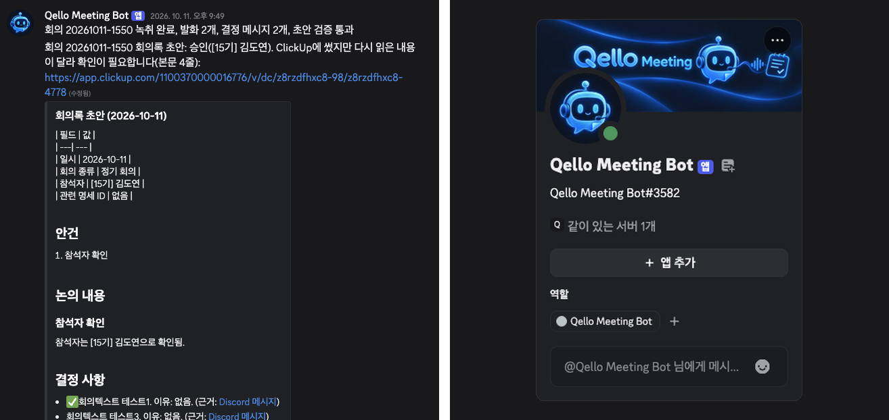
</p>


1. 음성 채널에 들어가 회의 채널에서 `/회의녹음 시작`을 입력하고, 회의가 끝나면 `/회의녹음 종료`를 입력한다.

   

2. 몇 분 뒤 회의 채널에 녹취 완료 알림과 회의록 초안이 올라온다(위 왼쪽 화면).

   [SCREENSHOT: 승인 전 초안 메시지의 `승인`·`수정`·`거절` 버튼]

3. 팀원이 `승인`을 누르면 Confluence `회의록` 아래에 페이지가 생기고, 초안 메시지에 링크가 적힌다.

   [SCREENSHOT: Confluence에 만들어진 `YYYY-MM-DD 정기 회의` 페이지. 결정 사항의 근거 링크가 그대로 남아 있는 것을 보여 준다]

4. 처리 중 실패하면 회의 채널에 알림이 온다.

   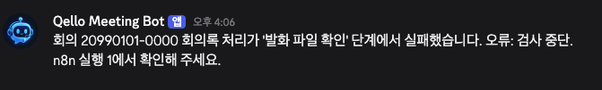

## 11. 저장소 구조와 작업 방식

```
src/                 녹음 봇
workflows/src/       n8n Code 노드 원본 (JSON은 scripts/build-workflow.js로 만든다)
scripts/             빌드, 차이 검사, 배포, 테스트, preflight
docs/design/         설계 문서
docs/decisions/      결정 기록
docs/assets/         배너와 다이어그램 원본(HTML)과 SVG
```
